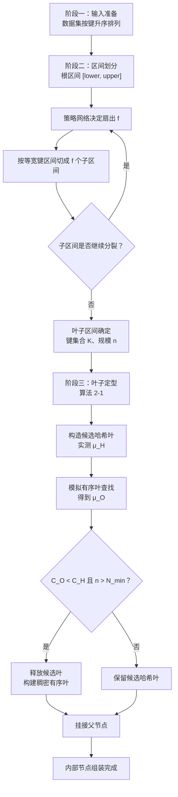

# 第二章配图

> ASCII 图用于确定结构与标注位置，正式论文建议用 draw.io / Visio 按此结构重绘。
> 图 2-2 另附 Mermaid 源码，可直接渲染或作为重绘底稿。

## 图 2-1 两种叶子的结构与点查路径

**图 2-1(a) 哈希叶的结构与点查路径**

```
叶头：lower … upper    c = 12    n = 7    r = 2

┌──────┬──────┬──────┬──────┬──────┬──────┬──────┬──────┬──────┬──────┬──────┬──────┐
│ 槽号 │  0   │  1   │  2   │  3   │  4   │  5   │  6   │  7   │  8   │  9   │ 10   │ 11   │
├──────┼──────┼──────┼──────┼──────┼──────┼──────┼──────┼──────┼──────┼──────┼──────┤
│ 键   │ k17  │  ∅   │ k05  │ k23  │  ∅   │ k11  │  ∅   │ k31  │ k08  │  ∅   │ k02  │ k19  │
├──────┼──────┼──────┼──────┼──────┼──────┼──────┼──────┼──────┼──────┼──────┼──────┤
│ 位图 │  1   │  0   │  1   │  1   │  0   │  1   │  0   │  1   │  1   │  0   │  1   │  1   │
└──────┴──────┴──────┴──────┴──────┴──────┴──────┴──────┴──────┴──────┴──────┴──────┘
                                                                     ▲
                                                    空间放大 α = 7/12

点查 k05：h(k05) = 4
  i = 0    槽 4   ∅
  i = 1    槽 3   k23       槽 5   k11        ← 左、右交替探测
  i = 2    槽 2   k05 ✓     槽 6   ∅

最大探测半径 r = 2，单次点查最多访问 2r + 1 = 5 个槽
```

**图 2-1(b) 有序叶的结构与点查路径**

```
叶头：lower … upper    c = n = 10    α = 1

┌──────┬────┬────┬────┬────┬────┬────┬────┬────┬────┬────┐
│ 槽号 │ 0  │ 1  │ 2  │ 3  │ 4  │ 5  │ 6  │ 7  │ 8  │ 9  │
├──────┼────┼────┼────┼────┼────┼────┼────┼────┼────┼────┤
│ 键   │ 2  │ 5  │ 8  │ 11 │ 15 │ 19 │ 23 │ 31 │ 60 │ 80 │
├──────┼────┼────┼────┼────┼────┼────┼────┼────┼────┼────┤
│ 位图 │ 1  │ 1  │ 1  │ 1  │ 1  │ 1  │ 1  │ 1  │ 1  │ 1  │
└──────┴────┴────┴────┴────┴────┴────┴────┴────┴────┴────┘
                                  ▲
                      预测位置 p = 3

点查 k = 31：
  ① 线性预测
     p = ⌊(n−1)(k − k_min)/(k_max − k_min)⌋ = ⌊9 × 29 / 78⌋ = 3
     读 array[3] = 11 < 31
  ② 向右 gallop（倍增步长）
     偏移 1 → 15      偏移 2 → 19      偏移 4 → 31（停）
     得到括号区间 [6, 7]
  ③ 括号内二分
     mid = 6 → 23     mid = 7 → 31 ✓
```

**图题**

- 图 2-1(a) 哈希叶的结构与点查路径
- 图 2-1(b) 有序叶的结构与点查路径

## 图 2-2 索引构建流程与叶型判定的位置

```
┌──────────────────────────────────────────────┐
│ 阶段一：输入准备                              │
│   数据集按键升序排列                          │
└───────────────────────┬──────────────────────┘
                        ▼
┌──────────────────────────────────────────────┐
│ 阶段二：自顶向下区间划分                      │
│                                              │
│   根区间 [lower, upper]                       │
│          │                                   │
│          ▼                                   │
│   ┌───────────────────────┐                  │
│   │ 策略网络决定扇出 f    │◄──────┐          │
│   └───────────┬───────────┘       │          │
│               ▼                   │          │
│   按等宽键区间切成 f 个子区间     │          │
│               │                   │          │
│               ├── 仍需分裂 ───────┘          │
│               │                              │
│               └── 不再分裂 → 叶子区间确定     │
└───────────────────────┬──────────────────────┘
                        ▼
┌──────────────────────────────────────────────┐
│ 阶段三：叶子定型（算法 2-1）                  │
│                                              │
│   构造候选哈希叶 ──► 实测 μ_H                 │
│   模拟有序叶查找 ──► 得到 μ_O                 │
│          │                                   │
│          ▼                                   │
│   比较 C_O 与 C_H（式 2-9）                   │
│          │                                   │
│          ├── C_O < C_H 且 n > N_min → 有序叶 │
│          └── 否则                  → 哈希叶 │
└───────────────────────┬──────────────────────┘
                        ▼
              挂接父节点 → 内部节点组装 → 整树完成
```

**图题**：图 2-2 索引构建流程与叶型判定的位置

**Mermaid 源码（图 2-2）**


